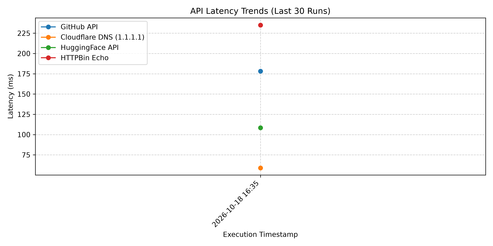

# 🌐 Automated Cloud API Observability & Benchmark Suite

*Automated test execution timestamp:* **2026-10-18 16:35:18 UTC**

An automated reliability and performance testing engine that monitors core tech infrastructure APIs, logs round-trip response latencies, tracks P95 response SLA degradation, and records data directly into Git.

## 📈 System SLA & Latency Performance Summary

| Service | Status | Current Latency | Avg Latency | P95 Latency | SLA Uptime |
| :--- | :--- | :--- | :--- | :--- | :--- |
| **GitHub API** | `200 OK` | `178.24 ms` | `178.24 ms` | `178.24 ms` | `100.0%` |
| **Cloudflare DNS (1.1.1.1)** | `400 FAIL` | `58.95 ms` | `58.95 ms` | `58.95 ms` | `0.0%` |
| **HuggingFace API** | `200 OK` | `108.42 ms` | `108.42 ms` | `108.42 ms` | `100.0%` |
| **HTTPBin Echo** | `200 OK` | `235.09 ms` | `235.09 ms` | `235.09 ms` | `100.0%` |

### 📊 Historical Latency Trend

---

### 🗄️ Historical Dataset
All raw performance benchmarks are continuously logged to [`history.csv`](./history.csv) on every automated run.

---
*Built with Python (`requests`, `pandas`, `matplotlib`) and GitHub Actions.*
